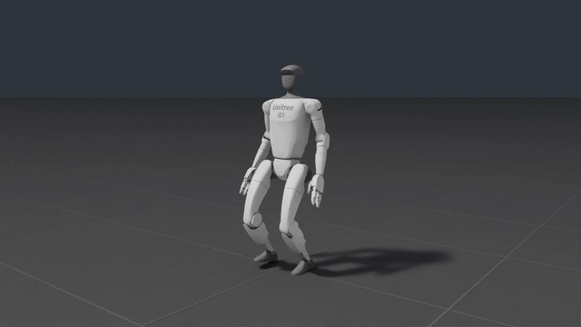
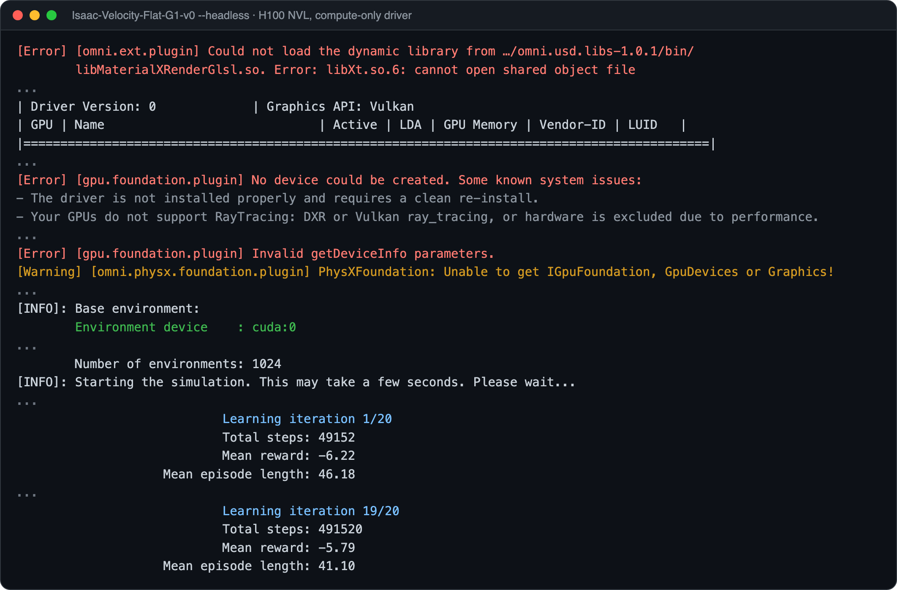
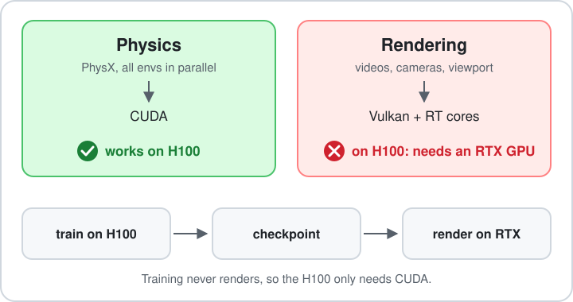

# Isaac Lab on H100: train headless, render elsewhere

**Isaac Lab 2.x · Isaac Sim 5.x · tested on H100 NVL**

**Website:** [kyry.me/isaaclab-h100](https://kyry.me/isaaclab-h100/)

[](https://github.com/isaac-sim/IsaacLab/tree/v2.3.2)
[](https://docs.isaacsim.omniverse.nvidia.com/5.1.0/)
[](docs/02-tested-versions.md)
[](LICENSE)
[](LICENSE-docs)

<p align="center">
  <a href="https://github.com/Kyk0/isaaclab-h100/releases/download/v0.1.0/g1-walk.mp4"></a>
</p>
<p align="center"><sub>Trained headless on an H100, rendered on an RTX GPU. <a href="https://github.com/Kyk0/isaaclab-h100/releases/download/v0.1.0/g1-walk.mp4">Full video (20 s, 1080p)</a></sub></p>

<!-- Suggested GitHub description:
Train Isaac Lab 2.x policies headless on H100 GPUs: what works, which errors are harmless, and a ready G1 USD. -->
<!-- Suggested topics: isaac-lab, isaac-sim, h100, a100, reinforcement-learning, humanoid, robotics -->

NVIDIA says Isaac Sim does not support GPUs without RT cores, like the H100. That is about **rendering**. Training does not render: the physics runs on CUDA. So headless RL training works on an H100.

We have trained humanoid policies this way on shared H100 servers since June 2026, including fine-tuning NVIDIA's [SONIC](https://github.com/NVlabs/GR00T-WholeBodyControl) controller for the Unitree G1. This repo shows exactly what we ran and which errors you can ignore. It is a community-tested setup, not one supported by NVIDIA.

Developed at the Advanced Telerobotics Research Lab, Kent State University.

## TL;DR

- **Training works.** Use `--headless`. Don't use cameras or `--video`.
- **Red errors at startup are fine** (`No device could be created` and similar), as long as the log then prints `Environment device : cuda:0` and training starts.

    <p align="center">
      
    </p>

- **Videos and cameras don't work.** Render on a machine with an RTX GPU.
- **Can't render anything, not even MuJoCo?** Your server probably has the compute-only driver (`nvidia-headless-*-server`). It ships without Vulkan and EGL. Ask your admin for the full driver (`nvidia-driver-*-open`).
- **Robot from URDF fails to load?** On some servers the URDF → USD conversion crashes. Convert once on an RTX machine (or download our G1 USD) and load the USD instead.

<p align="center">
  
</p>

## What works on our H100

| | H100 | RTX GPU |
|---|---|---|
| Headless RL training | ✅ | ✅ |
| Loading a robot USD | ✅ | ✅ |
| URDF → USD conversion | ⚠️ fails on some servers | ✅ |
| MuJoCo rendering | ⚠️ only with the full driver | ✅ |
| Isaac Sim videos, cameras, viewport | ❌ | ✅ |

Full details per driver and machine: [tested versions](docs/02-tested-versions.md).

**A100:** same reason (no RT cores), so it should behave the same, but we have not tested it. If you run Isaac Lab on an A100, H200, B200, L40S or anything else not listed, please [send a GPU report](../../issues/new?template=gpu-report.md) with the output of `scripts/collect_env.sh`. We add every report to the table with credit.

**Isaac Lab 3.0?** It came out on 2026-10-20. Its default install runs without Isaac Sim (Newton physics), so most of these renderer problems go away. Lots of projects, SONIC included, are built on Isaac Lab 2.x and will stay there for a while. This guide is for them. See [alternatives](docs/07-alternatives.md).

## Quickstart

```bash
# 1. Check your machine
bash scripts/collect_env.sh

# 2. Install Isaac Lab 2.x (conda + pip): see docs/03-install.md

# 3. Train Isaac Lab's G1 walking task, headless
cd <ISAACLAB_DIR>
./isaaclab.sh -p scripts/reinforcement_learning/rsl_rl/train.py \
  --task Isaac-Velocity-Flat-G1-v0 --headless --num_envs 4096 --max_iterations 20
```

That's it for most people. More:

- **SONIC fine-tune** from NVIDIA's released checkpoint: [docs/04-train-headless.md](docs/04-train-headless.md)
- **Your own robot:** convert URDF → USD on an RTX machine, copy it to the H100: [docs/05-robot-usd.md](docs/05-robot-usd.md)

## Docs

1. [Why it works](docs/01-why-it-works.md)
2. [Tested versions](docs/02-tested-versions.md)
3. [Install](docs/03-install.md)
4. [Train headless](docs/04-train-headless.md)
5. [Robot USD](docs/05-robot-usd.md)
6. [Troubleshooting](docs/06-troubleshooting.md): search your exact error here
7. [Alternatives](docs/07-alternatives.md): mjlab, Isaac Lab 3.0, containers, Slurm

## Ready G1 USD

The Unitree G1 exactly as SONIC uses it, already converted. Download it if you train SONIC or don't want to convert yourself:

```bash
bash scripts/download_usd.sh    # downloads from Hugging Face, checks sha256, unpacks to usd/g1_sonic/
```

The archive lives at [huggingface.co/datasets/Kyry10/unitree-g1-usd](https://huggingface.co/datasets/Kyry10/unitree-g1-usd).

```bash
# check it loads
python scripts/convert_robot.py --verify usd/g1_sonic/g1_sonic.usd --base_height 0.76
```

Isaac Lab's built-in G1 tasks don't need it; they download NVIDIA's own G1 model. License: Unitree meshes (BSD 3-Clause), URDF edits by BeyondMimic (MIT) and NVIDIA (Apache 2.0). Details: [docs/05-robot-usd.md](docs/05-robot-usd.md).

## Scripts

| Script | What it does |
|---|---|
| [collect_env.sh](scripts/collect_env.sh) | Prints your GPU, driver, versions, and whether Vulkan is available |
| [download_usd.sh](scripts/download_usd.sh) | Downloads and checks the G1 USD |
| [convert_robot.py](scripts/convert_robot.py) | Converts your URDF to USD, and `--verify` checks that it loads |
| [train_headless_example.sh](scripts/train_headless_example.sh) | SONIC fine-tune, headless |
| [slurm_example.sbatch](scripts/slurm_example.sbatch) | Slurm starting template (not run on a cluster yet) |

## Roadmap

- **v0.1 (now):** run Isaac Lab 2.x headless on H100
- **v0.2:** train on H100, render on RTX: checkpoint sync, RTX rendering, browser replay with [viser](https://github.com/nerfstudio-project/viser)
- **v0.3:** Isaac Lab 3.x, containers, Slurm

## License and citation

Scripts: [MIT](LICENSE). Docs: [CC BY 4.0](LICENSE-docs). The G1 USD keeps its upstream licenses. To cite this guide, use [CITATION.cff](CITATION.cff). No code from Isaac Lab, Isaac Sim or SONIC is included; we only link to them.
