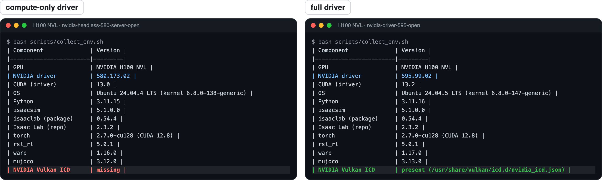

# 1. Why it works

The short version: Isaac Sim uses the GPU for two different jobs, and training only needs one of them.

## Two separate GPU jobs

<p align="center">
  
</p>

| | Physics | Rendering |
|---|---|---|
| What | PhysX GPU pipeline: rigid bodies, articulations, contacts, all envs in parallel | RTX renderer: viewport, camera sensors, `--video` |
| API | CUDA | Vulkan (plus ray tracing) |
| Needs RT cores | no | yes |
| Needs the NVIDIA graphics libraries (Vulkan ICD) | no | yes |
| Used by headless RL training | **yes** | no |

NVIDIA's [Isaac Sim 5.1 requirements](https://docs.isaacsim.omniverse.nvidia.com/5.1.0/installation/requirements.html) page says (the 6.x page has the same line): *"GPUs without RT Cores (A100, H100) are not supported."* That is about the RTX renderer. Headless training never calls it, so the H100 does exactly what it is good at: CUDA.

## What happens when training starts on an H100

1. Kit (the Isaac Sim runtime) starts and tries to create a Vulkan device for the renderer (`gpu.foundation.plugin`).
2. On a machine with the compute-only driver there is no NVIDIA Vulkan driver, so this step fails. You see a block of red `[Error]` lines (`No device could be created`, `GPU Foundation is not initialized!`, `Graphics plugins not available`) and a GPU table with `Driver Version: 0`.
3. Kit simply continues without a renderer. Isaac Lab creates the simulation on CUDA and prints:
   ```
   [INFO]: Base environment:
   	Environment device    : cuda:0
   ```
4. PhysX steps all environments on the H100, and training runs normally.

> [!TIP]
> Once you see `Environment device : cuda:0` and the first `Learning iteration` block, you can ignore every red line above it.

With the full driver (`nvidia-driver-595-open`, which includes `libnvidia-gl`), step 2 succeeds instead: Kit lists the H100 under `Graphics API: Vulkan` and the log is clean. Rendering images on an H100 is still outside what NVIDIA supports, so we render on an RTX GPU.

## Why "nothing renders" on many servers

If you have heard "Isaac Sim doesn't run on H100", there are usually two separate things behind it:

1. **The driver package.** Data-center installs often use the compute-only packages (`nvidia-headless-<ver>-server-open` + `libnvidia-compute-<ver>-server`). These ship without the Vulkan ICD (`/usr/share/vulkan/icd.d/nvidia_icd.json`) and without `libEGL_nvidia.so`, so *nothing* can render on the GPU: not Isaac Sim, and not MuJoCo with `MUJOCO_GL=egl` either. You can see this yourself: on Ubuntu 24.04, `apt-cache depends nvidia-headless-no-dkms-580-server-open` lists `libnvidia-compute-580-server` but no `libnvidia-gl-580-server`, while `nvidia-driver-580-server-open` depends on both. NVIDIA's [driver installation guide](https://docs.nvidia.com/datacenter/tesla/driver-installation-guide/ubuntu.html) describes the same split: a compute-only install leaves out "GL, EGL, Vulkan, X drivers", which come from `libnvidia-gl`.
2. **The hardware.** The H100 has no RT cores, which the RTX renderer needs.

The first one is an easy admin fix: install the full driver package. That is what our admin did, and MuJoCo EGL rendering started working on our H100 right away. (Adding `libnvidia-gl-<ver>-server` with exactly the same version as the running driver should work too.) The second one is simply what the H100 is built for, so do anything that draws with Isaac Sim (videos, cameras) on an RTX GPU, or skip RTX for watching policies: [doc 08](08-no-rtx-pipeline.md) replays them in the browser.

`scripts/collect_env.sh` tells you which driver setup you have. Real output from our two H100 hosts, same software, different driver package:

<p align="center">
  
</p>

## What the H100 is great for

Memory and headroom. With 94 GB you can run thousands of environments and large motion libraries side by side:

- Isaac Lab's G1 walking task trains at 4096 envs out of the box ([the walking clip in the README](../README.md) is a policy we trained this way).
- SONIC, a large motion-tracking controller, ran with 8192 environments in about 30 GB, so there is plenty of room left for bigger motion libraries or other jobs on a shared server.
