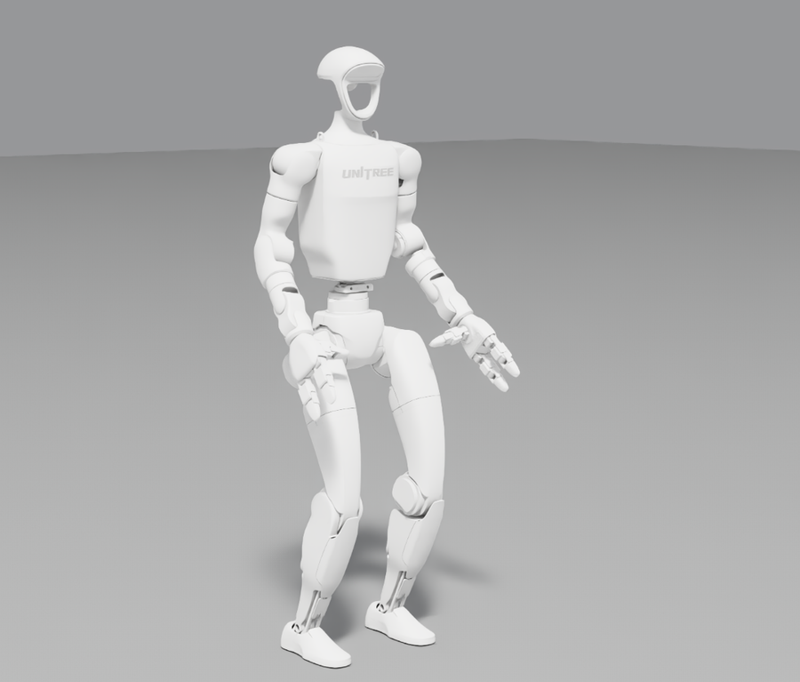

# 5. Robot USD

Isaac Lab can spawn a robot straight from URDF (`sim_utils.UrdfFileCfg`), converting URDF → USD at every launch. On some compute-only H100 servers that conversion fails, so the reliable path is: convert once, then load the ready USD with `sim_utils.UsdFileCfg`. That worked on every machine we have. For the G1 we did the conversion for you.

## The provided G1 USD

<p align="center">
  
</p>

A pre-converted Unitree G1 (29 DoF + hands, 51 bodies), exactly as SONIC uses it. It was converted from SONIC's `gear_sonic/data/assets/robot_description/urdf/g1/main.urdf` (commit `a0732b6`) with SONIC's own converter settings, using Isaac Lab 2.3.2 / Isaac Sim 5.1. The USD is not stored in this git repo; it is a separate download (11 MB zip, hosted on Hugging Face):

```bash
bash scripts/download_usd.sh      # downloads, checks sha256, unpacks into usd/g1_sonic/
# archive sha256: e4084104e4936a6cafa3d33e98ecadcc0473fb643c9e9819a6c6964917fedfa0
```

The archive is on Hugging Face: [Kyry10/unitree-g1-usd](https://huggingface.co/datasets/Kyry10/unitree-g1-usd). If the download fails, `download_usd.sh` exits with an error; you can always produce the same files yourself with `convert_robot.py --preset g1_sonic` on an RTX machine (see [Convert your own robot](#convert-your-own-robot)).

**License:** the meshes are Unitree's (BSD 3-Clause): all 49 mesh files used are byte-identical to Unitree's [unitree_ros](https://github.com/unitreerobotics/unitree_ros). The URDF is Unitree's G1 29-DoF description edited by BeyondMimic (MIT) and shipped in SONIC (Apache 2.0). Full texts are in `LICENSE-NOTICE.md` inside the archive.

Unpacked layout:

```
usd/g1_sonic/
  g1_sonic.usd              # thin top layer: point usd_path here
  configuration/            # the actual robot: base, physics, robot, sensor layers
    g1_sonic_base.usd
    g1_sonic_physics.usd
    g1_sonic_robot.usd
    g1_sonic_sensor.usd
  config.yaml               # UrdfConverterCfg used (local paths replaced by placeholders)
  LICENSE-NOTICE.md, LICENSE-Apache-2.0.txt
```

**Copy the whole directory.** `g1_sonic.usd` only references the files in `configuration/`, so on its own it loads as an empty prim.

If you only use Isaac Lab's built-in G1 tasks (`Isaac-Velocity-Flat-G1-v0` and others), you don't need this: they load NVIDIA's own G1 USD from its asset server.

### Load it

Replace the `spawn=sim_utils.UrdfFileCfg(...)` block of your `ArticulationCfg` with `UsdFileCfg`. Keep the same rigid-body, articulation and contact-sensor settings; the converter does not store those. Joint gains stay in `actuators`, unchanged.

```python
import isaaclab.sim as sim_utils
from isaaclab.assets import ArticulationCfg

G1_USD = "<THIS_REPO>/usd/g1_sonic/g1_sonic.usd"

G1_CFG = ArticulationCfg(
    spawn=sim_utils.UsdFileCfg(
        usd_path=G1_USD,
        activate_contact_sensors=True,
        rigid_props=sim_utils.RigidBodyPropertiesCfg(
            disable_gravity=False,
            retain_accelerations=False,
            linear_damping=0.0,
            angular_damping=0.0,
            max_linear_velocity=1000.0,
            max_angular_velocity=1000.0,
            max_depenetration_velocity=1.0,
        ),
        articulation_props=sim_utils.ArticulationRootPropertiesCfg(
            enabled_self_collisions=True,
            solver_position_iteration_count=8,
            solver_velocity_iteration_count=4,
        ),
    ),
    init_state=...,   # unchanged
    actuators=...,    # unchanged
)
```

These property values are the ones in SONIC's G1 config. For SONIC itself, that `spawn` block is in `gear_sonic/envs/manager_env/robots/g1.py`. Read the USD path from an environment variable if the file moves between machines.

### Check it

```bash
python scripts/convert_robot.py --verify usd/g1_sonic/g1_sonic.usd --base_height 0.76
# [convert_robot] device=cuda:0 joints=29 bodies=51
# [convert_robot] base height 0.768 m -> 0.702 m after 1 s
# [convert_robot] VERIFY OK
```

`--verify` spawns the USD with `UsdFileCfg` on a ground plane, holds the default pose with a stiff PD and steps physics for 1 s, then prints joints, bodies and base height. `--device cpu` runs PhysX on the CPU, which is useful on a GPU that is busy with other jobs.

| Where | Device | Result |
|---|---|---|
| Quadro RTX 6000 | cuda:0 | VERIFY OK, 13.6 s total |
| H100 host, compute-only driver | cpu | VERIFY OK, 8.7 s total; Kit renderer errors as usual |

## Convert your own robot

Run this on a machine with a full NVIDIA driver (an RTX workstation is the safe choice), then copy the output directory to the H100:

```bash
python scripts/convert_robot.py --urdf <ROBOT_URDF> --out_dir usd/my_robot            # add --capsules / --fix_base to match your UrdfFileCfg
python scripts/convert_robot.py --verify usd/my_robot/my_robot.usd --base_height <HEIGHT>
rsync -a usd/my_robot <H100_HOST>:<DATA_DIR>/usd/                                    # the whole directory
```

Use the same converter options your `UrdfFileCfg` had: `fix_base`, `replace_cylinders_with_capsules` (`--capsules`), and the joint drive. The script sets zero drive gains like most Isaac Lab robot configs, because the actuators set the gains. Anything else keeps the Isaac Lab default, and the converter writes every value to `<out_dir>/config.yaml`. For other options (`merge_fixed_joints`, `collider_type`, `self_collision`, …) edit the `UrdfConverterCfg` call in the script.

**Check the output, not the exit code.** When the conversion fails, Isaac Sim logs `[Fatal]` and the process can still exit with status 0. A good conversion prints `[convert_robot] USD: ...`, and the files in `configuration/` are larger than a few hundred bytes. A failed one leaves 492-byte placeholder files.

## Why: conversion can fail on a compute-only H100

On H100 host B (compute-only driver; host names as in [02-tested-versions.md](02-tested-versions.md)), converting SONIC's G1 URDF fails every time:

```
[Warning] [isaacsim.asset.importer.urdf] Asset convert failed with error status: Unsupported Format (/meshes/pelvis)
[Error] [omni.usd] Runtime Error: in Open at line 1059 of .../pxr/usd/usd/stage.cpp -- Failed to open layer @<out_dir>/configuration/pelvis.tmp.usd@
[Fatal] [omni.usd] attempted member lookup on NULL TfRefPtr<UsdStage>
```

What we tested on that host (Isaac Sim 5.1, Isaac Lab 2.3.2):

| Variant | Result |
|---|---|
| `--device cpu` | fails |
| `--device cuda:0` | fails |
| without `replace_cylinders_with_capsules` | fails |
| with `libXt.so.6` made loadable (`LD_LIBRARY_PATH=$CONDA_PREFIX/lib`) | fails |
| absolute mesh paths instead of `package://robot_description/...` | fails |
| same URDF on the RTX machine | works |
| USD converted on the RTX machine, loaded on this H100 host | **works** |

The STL mesh import is what fails: the converted layers are written as 492-byte placeholders. The root cause is still open (ideas welcome in an issue). On H100 host A, SONIC's G1 converted at launch in September 2026, when it still had the same compute-only driver as host B, and conversion at launch still works there after its driver change. So it depends on the host setup, not on the H100 or the driver package alone. The fix that always works: convert once on an RTX machine (or download the USD above) and load the USD.
